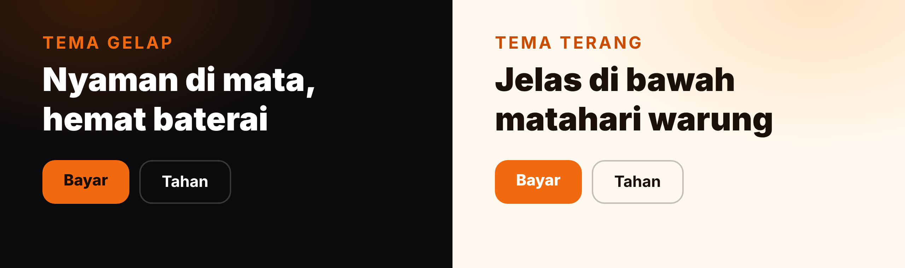

 

 

**Aplikasi kasir untuk warung, toko kecil, dan usaha rumahan. Dipasang sekali, dipakai tanpa internet.**

[Unduh](#unduh-dan-pasang) · [Fitur](#fitur) · [Cara pakai](#cara-pakai) · [Tanya jawab](#tanya-jawab)

---

## Kenapa RAON

Banyak aplikasi kasir meminta akun, langganan bulanan, atau menampilkan iklan di layar yang dipakai pelanggan. RAON dibuat untuk kebalikannya: buka, ketuk produk, terima uang, selesai. Semua data tersimpan di HP-mu sendiri.

---

## Fitur

<table>
  <tr>
    <td width="50%"></td>
    <td width="50%"></td>
  </tr>
  <tr>
    <td width="50%"></td>
    <td width="50%"></td>
  </tr>
  <tr>
    <td width="50%"></td>
    <td width="50%"></td>
  </tr>
  <tr>
    <td width="50%"></td>
    <td width="50%"></td>
  </tr>
</table>

Yang lebih rinci:

- **Pembayaran:** tunai dengan tombol Uang Pas dan nominal cepat, QRIS, dan transfer. Kembalian dihitung otomatis.
- **Keranjang:** diskon dalam rupiah atau persen, Item Bebas untuk barang yang belum terdaftar, dan Tahan untuk menyimpan transaksi sementara.
- **Koreksi:** transaksi yang salah bisa dibatalkan. Omzet turun dan stok barangnya kembali.
- **Stok:** boleh diisi, boleh dikosongkan kalau tidak perlu dilacak. Barang yang hampir habis diberi tanda.
- **Data contoh:** 20 produk contoh dengan satu ketukan untuk mencoba, dan bisa dihapus tanpa menyentuh produkmu.

---

## Dua tema

Tema gelap jadi bawaan. Ganti ke tema terang dari Pengaturan kalau layarmu sering kena cahaya.

---

## Unduh dan pasang

Atau buka halaman [Releases](https://github.com/asammanis89/RAON-KASIR-PUBLIC/releases/latest) untuk melihat catatan tiap versi.

1. Unduh `raon.apk` dari tombol di atas, langsung dari HP.
2. Buka berkas yang terunduh. Kalau Android bertanya soal "sumber tidak dikenal", izinkan untuk browser atau aplikasi file yang kamu pakai.
3. Ketuk **Pasang**, lalu buka RAON.
4. Ikuti panduan empat kartu yang muncul saat pertama dibuka.

Setelah terpasang, RAON memeriksa versi baru sendiri saat dibuka. Kalau ada, kamu tinggal pilih **Perbarui**.

> RAON dibagikan sebagai APK di GitHub, bukan lewat Play Store. Itu sebabnya Android menampilkan peringatan saat memasang. Unduh hanya dari halaman ini.

---

## Cara pakai

**Mulai berjualan**
1. Buka tab **Produk**, ketuk **Tambah Produk**, isi nama dan harga. Atau ketuk **Isi Data Contoh** untuk mencoba dulu.
2. Pindah ke tab **Kasir**, ketuk produk yang dibeli.
3. Ketuk **Bayar**, pilih **Uang Pas** atau nominal, lalu selesaikan.

**Cetak struk**
1. Pasangkan printer thermal 58mm lewat Pengaturan Bluetooth di HP.
2. Buka **Pengaturan** di RAON, pilih printer, dan izinkan Bluetooth.
3. Setelah transaksi selesai, ketuk cetak. Tanpa printer, struk tetap bisa dibagikan sebagai PDF.

**Tutup kasir**
Di tab **Laporan**, ketuk **Tutup Kasir**, isi kas awal, dan lihat berapa uang yang seharusnya ada di laci.

**Jaga datamu**
Karena data hanya ada di HP, buat cadangan dari **Pengaturan** secara rutin. RAON mengingatkan kalau sudah lama belum dicadangkan.

---

## Tanya jawab

<b>Apakah RAON benar-benar gratis?</b>

Ya. Tidak ada langganan, tidak ada iklan, dan tidak ada batas jumlah produk atau transaksi.

<b>Perlu internet?</b>

Tidak untuk berjualan. Internet hanya dipakai untuk mengecek dan mengunduh versi baru.

<b>Di mana datanya disimpan?</b>

Di database di HP-mu. RAON tidak punya akun dan tidak punya server. Kalau HP hilang atau rusak, datanya ikut hilang, jadi buat cadangan dan simpan berkasnya di tempat lain.

<b>Printer apa yang didukung?</b>

Printer thermal Bluetooth 58mm dengan perintah ESC/POS. Beri tahu kalau printermu bermasalah supaya bisa dicek.

<b>Bisa dipakai di iPhone?</b>

Belum. RAON hanya untuk Android.

<b>Update gagal terpasang.</b>

Unduh `raon.apk` terbaru dari halaman Releases dan pasang di atas versi lama. Data tidak hilang selama kamu tidak mencopot aplikasi.

---

Ada masalah atau saran? Buka tab **Issues** di repo ini.

