

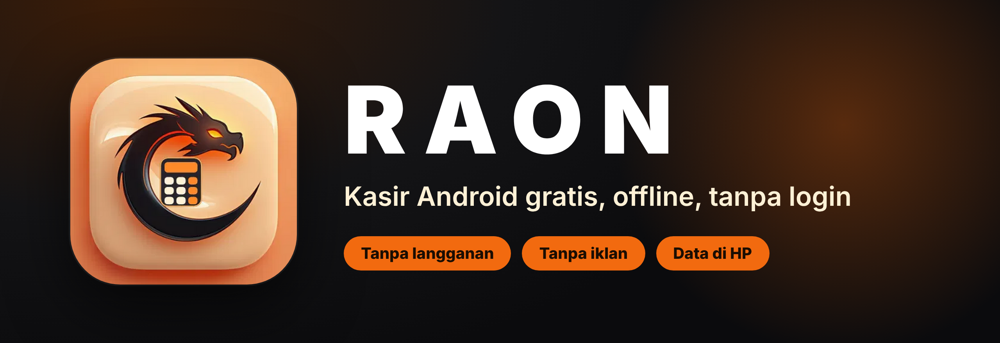

 

 

**Aplikasi kasir untuk warung, toko kecil, dan usaha rumahan. Dipasang sekali, dipakai tanpa internet.**

[Unduh](#unduh-dan-pasang) · [Tampilan](#tampilan-di-hp-tablet-dan-laptop) · [Fitur](#fitur) · [Cara pakai](#cara-pakai) · [Tanya jawab](#tanya-jawab)

 

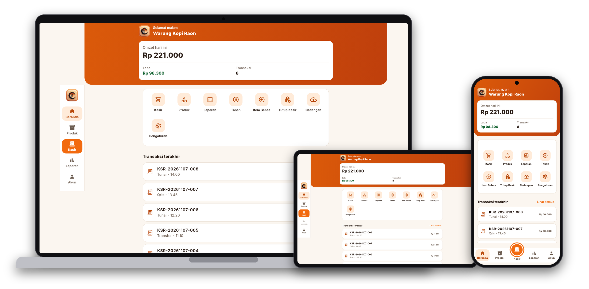

---

## Kenapa RAON

Banyak aplikasi kasir meminta akun, langganan bulanan, atau menampilkan iklan di layar yang dipakai pelanggan. RAON dibuat untuk kebalikannya: buka, ketuk produk, terima uang, selesai. Semua data tersimpan di HPmu sendiri.

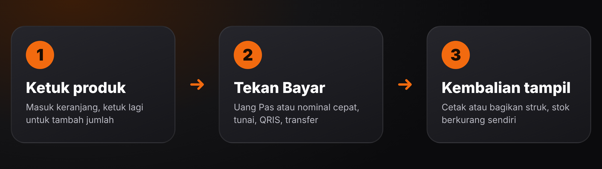

---

## Fitur

<table>
  <tr>
    <td width="50%">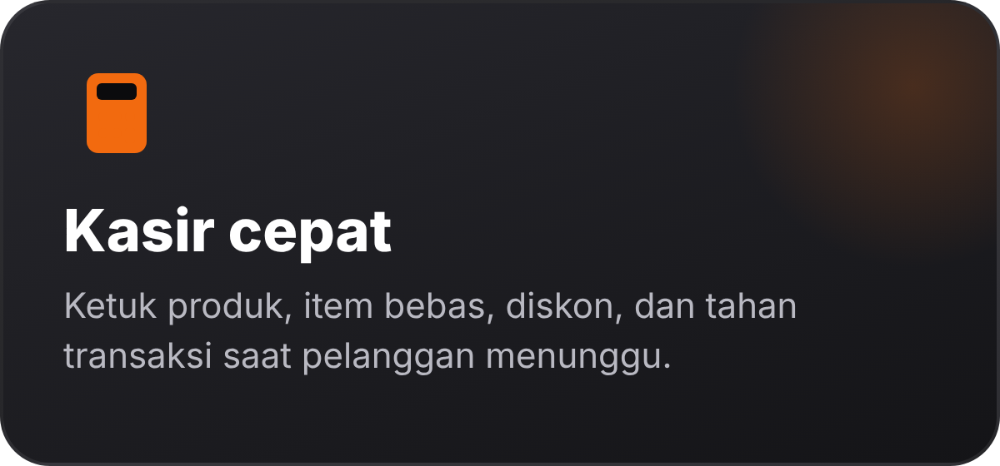</td>
    <td width="50%">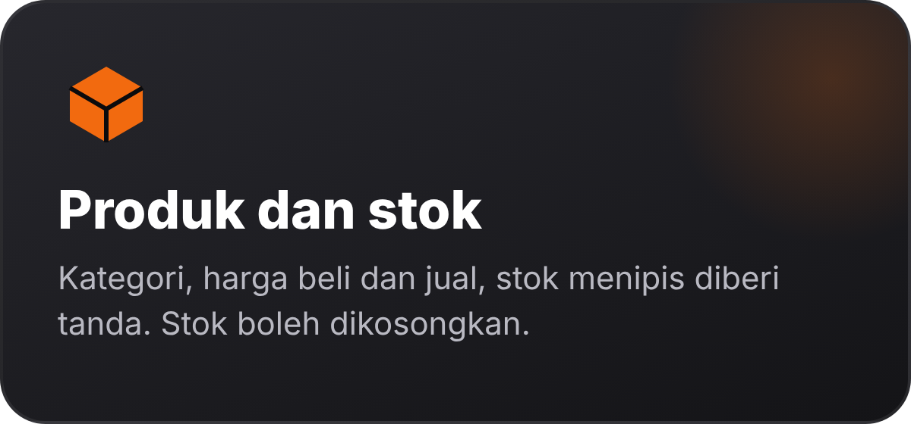</td>
  </tr>
  <tr>
    <td width="50%">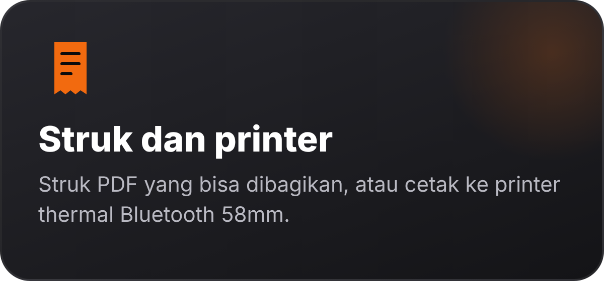</td>
    <td width="50%">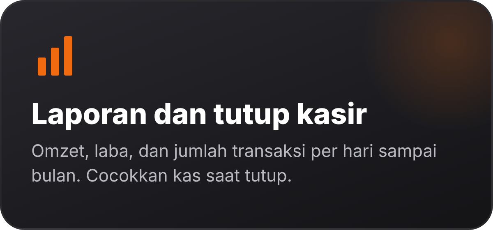</td>
  </tr>
  <tr>
    <td width="50%">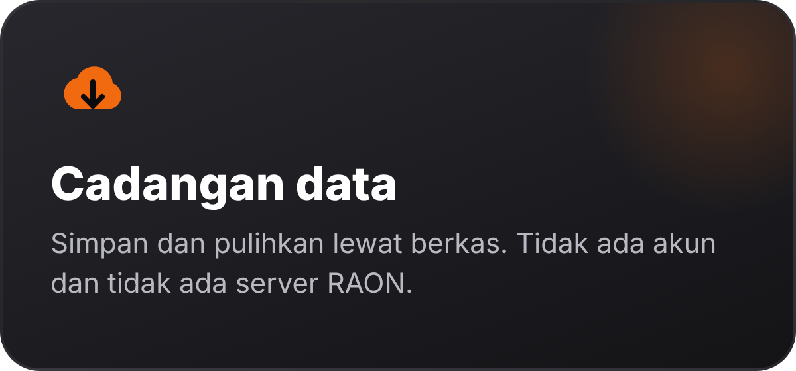</td>
    <td width="50%">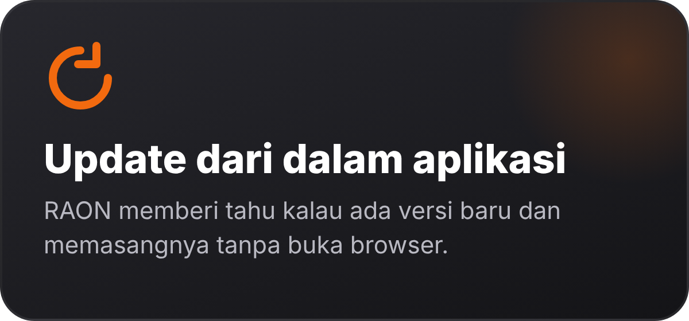</td>
  </tr>
  <tr>
    <td width="50%">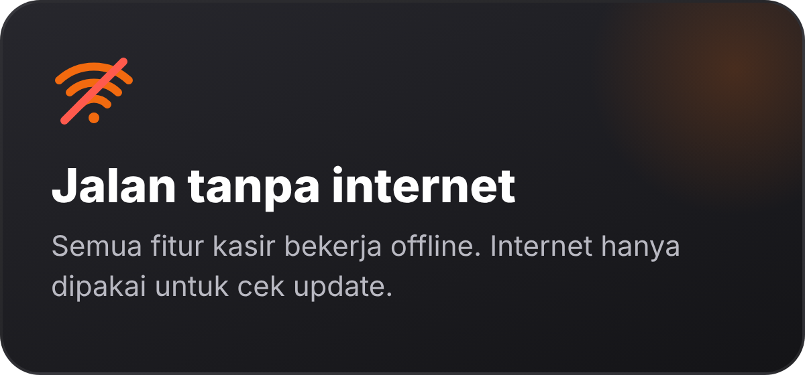</td>
    <td width="50%">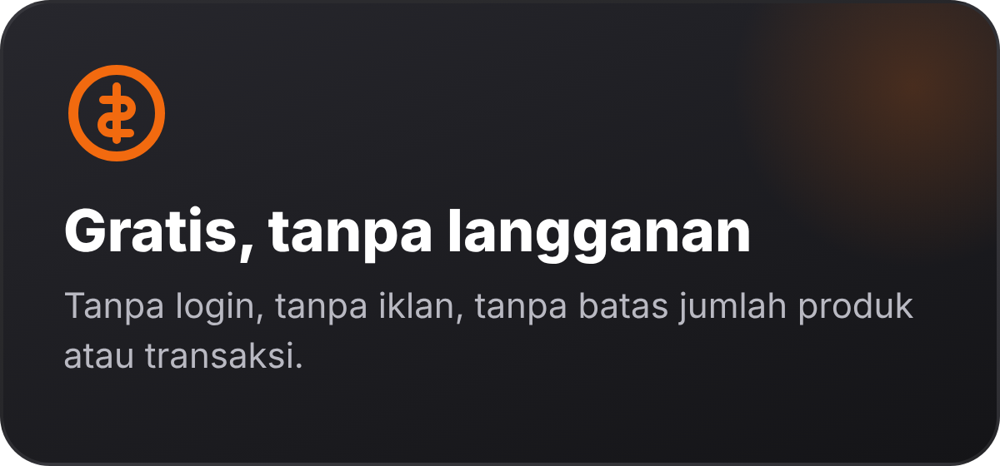</td>
  </tr>
</table>

Yang lebih rinci:

- **Pembayaran:** tunai dengan tombol Uang Pas dan nominal cepat, QRIS, dan transfer. Kembalian dihitung otomatis.
- **Keranjang:** diskon dalam rupiah atau persen, Item Bebas untuk barang yang belum terdaftar, dan Tahan untuk menyimpan transaksi sementara.
- **Koreksi:** transaksi yang salah bisa dibatalkan. Omzet turun dan stok barangnya kembali.
- **Stok:** boleh diisi, boleh dikosongkan kalau tidak perlu dilacak. Barang yang hampir habis diberi tanda.
- **Laporan sesuai kebutuhan:** pilih Hari ini, Kemarin, 7 hari, Bulan ini, Bulan lalu, atau rentang tanggal sendiri; saring per metode bayar; lihat omzet, laba kotor, pengeluaran, laba bersih, rata-rata, jam paling ramai, penjualan per kategori, dan produk terjual. Bagikan sebagai PDF atau CSV untuk Excel.
- **Pengeluaran:** catat es batu, listrik, plastik, atau biaya harian lain; laba bersih otomatis berkurang.
- **Utang pelanggan:** pilih metode Utang dengan nama pelanggan, pantau di Piutang, lalu lunasi lewat tunai, QRIS, atau transfer. Struk menyebut nama dan status utang.
- **Tutup Kasir:** kas awal, penjualan tunai, utang yang dilunasi tunai, dan pengeluaran dihitung jadi uang yang seharusnya ada di laci, lalu dibandingkan dengan hasil hitungmu.
- **Pengingat:** notifikasi untuk tutup kasir tiap hari, stok hampir habis, utang yang menunggak, dan cadangan data. Dinyalakan sendiri di Pengaturan, semuanya mati secara bawaan.
- **Data contoh:** 20 produk contoh dengan satu ketukan untuk mencoba, dan bisa dihapus tanpa menyentuh produkmu.

---

## Tampilan di HP, tablet, dan laptop

RAON mengikuti ukuran layar. Di HP menunya ada di bilah bawah dengan lima tab dan penanda hijau di tab yang aktif. Di tablet dan laptop (misalnya Chromebook atau emulator) menunya pindah ke samping, daftar dibatasi lebarnya supaya tetap enak dibaca, dan layar Kasir menampilkan keranjang di sisi kanan.

> Semua gambar di bagian ini dipotret langsung dari aplikasi yang berjalan dengan data contoh, bukan dari mockup desain. Dipotret di lingkungan uji, jadi font dan status bar di HP-mu bisa sedikit berbeda.

### Beranda

Omzet, laba bersih, dan jumlah transaksi hari ini sekali lihat, tombol Kasir dan Laporan, delapan pintasan (Produk, Tahan, Item Bebas, Tutup Kasir, Pengeluaran, Piutang, Cadangan, Pengaturan), peringatan stok hampir habis dan utang belum lunas, dan transaksi terakhir.

### Kasir

Ketuk produk, keranjang terisi, tombol **Tahan** dan **Bayar** selalu terlihat. Tiap produk punya huruf awal berwarna, dan yang sudah di keranjang diberi bingkai hijau beserta jumlahnya.

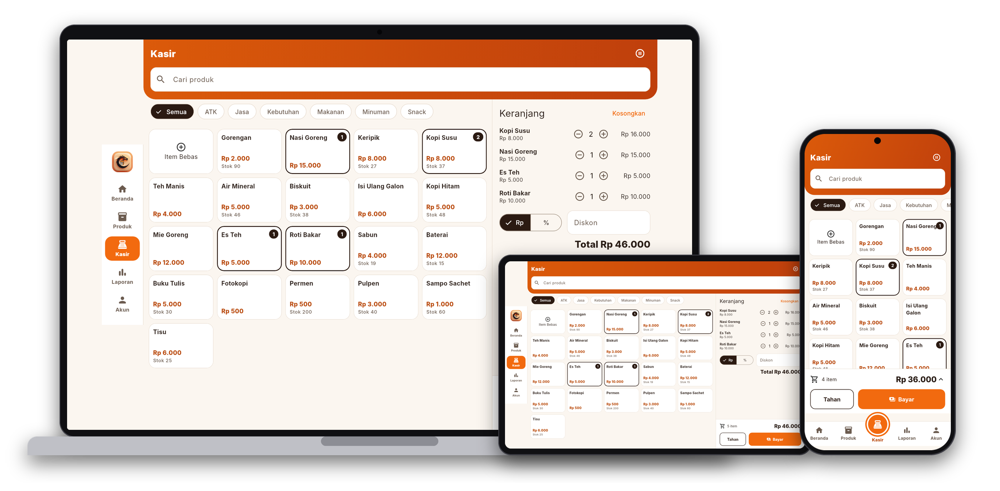

### Pembayaran

Total besar di atas, pilihan Tunai, QRIS, atau Transfer, nominal cepat, dan kembalian langsung dihitung.

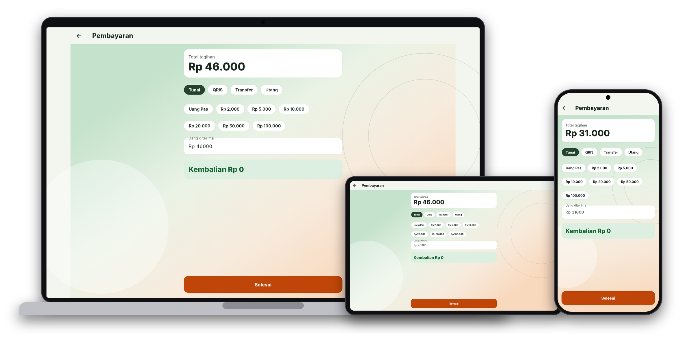

### Produk

Cari, tambah, ubah, dan lihat stok. Produk yang hampir habis diberi tanda.

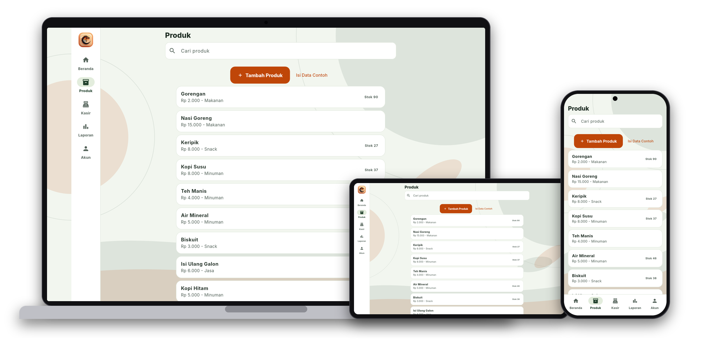

### Laporan

Pilih periode (atau rentang tanggal sendiri) dan metode bayar, lalu lihat omzet, laba kotor dan bersih, pengeluaran, jam ramai, rincian per metode dan kategori, produk terjual, dan riwayat. Tombol di kanan atas membagikan PDF atau CSV. **Tutup Kasir** mencocokkan uang di laci.

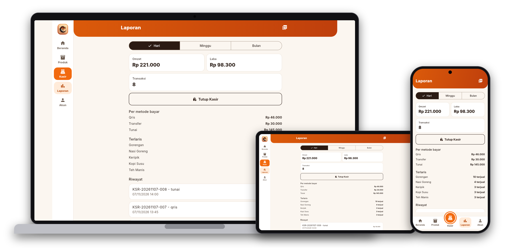

### Pengaturan

Nama toko, alamat, pesan di struk, mode gelap, gambar QRIS, printer, cadangan, dan cek pembaruan.

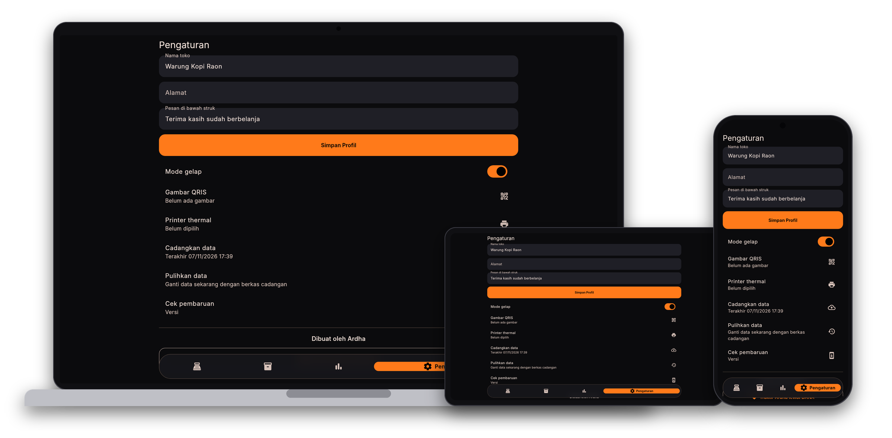

### Tema terang dan gelap

Tema terang jadi bawaan: latar sage lembut dengan siluet hijau dan oranye, kartu putih, dan tombol oranye. Nyaman dipakai seharian. Kalau lebih suka gelap, nyalakan Mode gelap di Pengaturan.

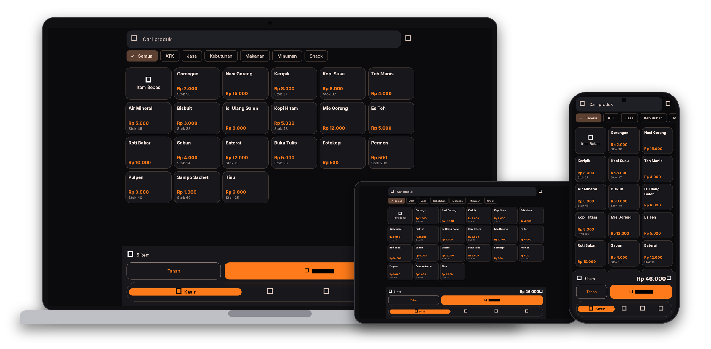

### Semua halaman di HP

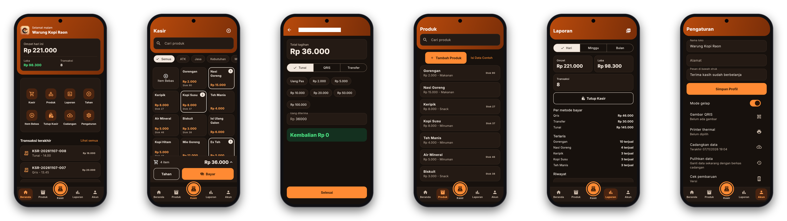

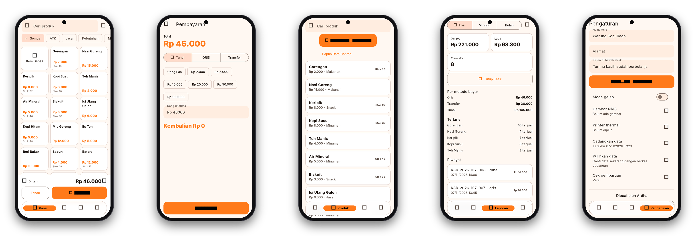

### Panduan saat pertama dibuka

Empat kartu singkat. Kartu terakhir berisi tombol saweran DANA, dan tombol yang sama ada di Pengaturan.

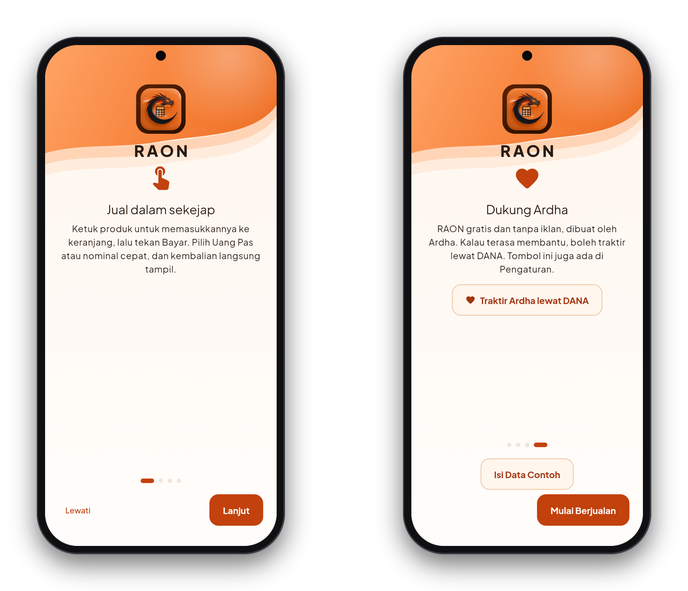

---

## Unduh dan pasang

Atau buka halaman [Releases](https://github.com/asammanis89/RAON-KASIR-PUBLIC/releases/latest) untuk melihat catatan tiap versi.

1. Unduh `raon.apk` dari tombol di atas, langsung dari HP.
2. Buka berkas yang terunduh. Kalau Android bertanya soal "sumber tidak dikenal", izinkan untuk browser atau aplikasi file yang kamu pakai.
3. Ketuk **Pasang**, lalu buka RAON.
4. Ikuti panduan empat kartu yang muncul saat pertama dibuka.

Setelah terpasang, RAON memeriksa versi baru sendiri saat dibuka. Kalau ada, kamu tinggal pilih **Perbarui**.

> RAON dibagikan sebagai APK di GitHub, bukan lewat Play Store. Itu sebabnya Android menampilkan peringatan saat memasang. Unduh hanya dari halaman ini.

---

## Cara pakai

**Mulai berjualan**
1. Buka tab **Produk**, ketuk **Tambah Produk**, isi nama dan harga. Atau ketuk **Isi Data Contoh** untuk mencoba dulu.
2. Pindah ke tab **Kasir**, ketuk produk yang dibeli.
3. Ketuk **Bayar**, pilih **Uang Pas** atau nominal, lalu selesaikan.

**Cetak struk**
1. Pasangkan printer thermal 58mm lewat Pengaturan Bluetooth di HP.
2. Buka **Pengaturan** di RAON, pilih printer, dan izinkan Bluetooth.
3. Setelah transaksi selesai, ketuk cetak. Tanpa printer, struk tetap bisa dibagikan sebagai PDF.

**Tutup kasir**
Di tab **Laporan**, ketuk **Tutup Kasir**, isi kas awal, dan lihat berapa uang yang seharusnya ada di laci.

**Jaga datamu**
Karena data hanya ada di HP, buat cadangan dari **Pengaturan** secara rutin. RAON mengingatkan kalau sudah lama belum dicadangkan.

---

## Tanya jawab

<b>Apakah RAON benar-benar gratis?</b>

Ya. Tidak ada langganan, tidak ada iklan, dan tidak ada batas jumlah produk atau transaksi.

<b>Perlu internet?</b>

Tidak untuk berjualan. Internet hanya dipakai untuk mengecek dan mengunduh versi baru.

<b>Di mana datanya disimpan?</b>

Di database di HP-mu. RAON tidak punya akun dan tidak punya server. Kalau HP hilang atau rusak, datanya ikut hilang, jadi buat cadangan dan simpan berkasnya di tempat lain.

<b>Printer apa yang didukung?</b>

Printer thermal Bluetooth 58mm dengan perintah ESC/POS. Beri tahu kalau printermu bermasalah supaya bisa dicek.

<b>Bisa dipakai di iPhone?</b>

Belum. RAON hanya untuk Android.

<b>Update gagal terpasang.</b>

Unduh `raon.apk` terbaru dari halaman Releases dan pasang di atas versi lama. Data tidak hilang selama kamu tidak mencopot aplikasi.

---

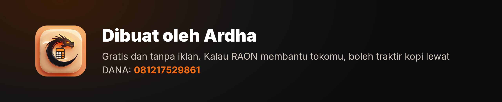

Ada masalah atau saran? Buka tab **Issues** di repo ini.

